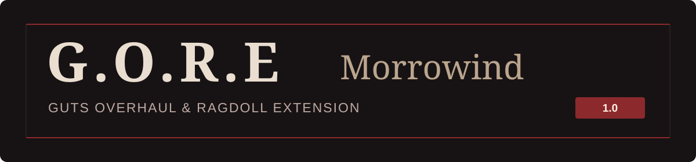

<strong>Физика тел и предметов · Расчленение и кровь · Боевая система с активной защитой</strong>

<a href="https://github.com/vault13xcv-star/4656/releases/download/gore-v1.0/GORE-Morrowind-1.0-Windows-x64.zip"><strong>Скачать Windows x64 — 1.0</strong></a> · <a href="https://github.com/vault13xcv-star/4656/releases/tag/gore-v1.0">Релиз и контрольные суммы</a> · <a href="https://github.com/vault13xcv-star/4656/releases/download/gore-v1.0/GORE-Morrowind-1.0-Source.zip">Исходники ZIP</a> · <a href="docs/GORE-Morrowind.en.md">English</a>

**G.O.R.E: Morrowind 1.0** — модифицированная сборка OpenMW 0.51. Название расшифровывается как **Guts Overhaul & Ragdoll Extension**. Проект ранее назывался Brutal Morrowind; эта версия объединяет физику, расчленение, кровь и обновлённые правила боя в основном релизе.

Запускать нужно движок из архива G.O.R.E. Оригинальные данные Morrowind в архив не входят; используется ваша установленная игра и конфигурация OpenMW.

[Возможности](#возможности) · [Установка](#установка-и-запуск) · [Управление](#управление) · [Настройки](#настройки) · [Совместимость](#совместимость-и-ограничения)

## Возможности

### Физика

- Рэгдоллы погибших НПС и поддерживаемых существ, физические отрубленные части тела.
- Физика подбираемых предметов: удары оружием, снарядами и магией двигают предметы; они сталкиваются с окружением и друг с другом.
- Стрелы, болты и метательное оружие летят с учётом гравитации. От твёрдых поверхностей отскакивают, в живых и мёртвых противниках остаются закреплёнными.
- Проникающие попадания вызывают небольшое кровотечение у органических целей. Выпущенные снаряды после столкновения нельзя подобрать; бесконечный боезапас из них не создаётся.
- Импульс смерти зависит от попадания и оружия. Смерть от продолжительного урона не воспроизводит взрывную волну спустя несколько секунд после попадания.

### Расчленение и кровь

- Результат зависит от оружия, направления финального удара и части тела: отсечение конечностей, обезглавливание, поперечное и продольное разделение тела, разрушение головы.
- Двуручные молоты при подходящем ударе в торс могут отрывать 3–5 конечностей; разрезы тела сопровождаются физическими внутренностями.
- Брызги, фонтаны из ран, следы крови на поверхностях и лужи; количество крови, время сохранения следов и вероятность расчленения настраиваются.
- Броня и одежда остаются в инвентаре тела. Отделяемые части сохраняют подходящие части экипировки; цельная мантия не превращается в разрезанную модель.
- Есть элементальные эффекты огня, холода, электричества и яда, текстуры обугленных и отравленных тел. Огненные и ледяные отрывы частей не создают кровь.
- Органические существа кровоточат; механизмы, призраки и скелеты исключены из кровотечения.

### Бой и выносливость

- Физический контакт ближнего оружия или снаряда засчитывается без дополнительного случайного броска попадания — для игрока, НПС и существ.
- Навык оружия влияет на урон, замах, восстановление между атаками, износ и расход стамины. Сам атакующий выпад сохраняет исходную скорость. Ловкость влияет на темп боя и разброс дальних атак.
- Щит активный: своевременный подъём блокирует 100% физического урона, заранее поднятый щит — 30%. Подъём, удержание и попадания расходуют стамину; при её отсутствии щит опускается.
- Без щита ПКМ выполняет короткий рывок назад или вбок. Рывок расходует стамину, использует обычные столкновения и не даёт неуязвимости.
- Обычные ходьба и бег на суше бесплатны. Спринт ускоряет бег вдвое и расходует стамину. Бег назад вдвое медленнее, включая диагонали; спринт назад запрещён. Правило отхода задом относится и к НПС.
- В бою для естественного восстановления нужны две секунды передышки после действий. При полном истощении задержка составляет 3–10 секунд по Ловкости. Вне боя полный запас восстанавливается за 5–10 секунд по Выносливости, после задержки истощения, если она действует.
- Слабые частые попадания не вызывают бесконечную цепочку мини-станов. Невраждебные друг другу НПС и существа перехватывают физические атаки союзников без получения урона; удары не проходят сквозь них к игроку. Правила заклинаний сохраняются.

### Slow motion — по желанию

При убийстве последнего ближайшего противника время и звук на две секунды замедляются втрое. Используется та же проверка ближайших врагов, что ограничивает отдых.

**Esc → Settings → Physics → Last enemy slow motion** — включить или выключить. Настройка включена по умолчанию. Выключение отменяет и уже начавшееся замедление; перезапуск игры не требуется.

## Установка и запуск

1. Установите **Morrowind**. Если OpenMW ещё не настроен, установите официальный [OpenMW](https://openmw.org/downloads/) и один раз пройдите его мастер настройки, указав папку Morrowind `Data Files`. Проверьте обычный запуск игры и закройте её.
2. Скачайте [GORE-Morrowind-1.0-Windows-x64.zip](https://github.com/vault13xcv-star/4656/releases/download/gore-v1.0/GORE-Morrowind-1.0-Windows-x64.zip). Архив `Source` содержит исходный код и для запуска не подходит.
3. **Полностью распакуйте** Windows-архив в отдельную папку. Сохраните вместе `openmw.exe`, DLL, `openmw.cfg`, `defaults.bin` и папку `resources`. Не переносите один EXE поверх другой версии OpenMW.
4. Запустите **`GORE-Morrowind.cmd`**. Он запускает `openmw.exe` из этой же папки; используется существующая конфигурация OpenMW и её список игровых данных. Подключать отдельный ESP для G.O.R.E не нужно.
5. Перед продолжением старого прохождения сделайте копию сохранений. В игре откройте вкладку **Physics**, настройте кровь, физику и при необходимости отключите slow motion.

Для русской версии данных Morrowind в архиве есть **`OpenMW-Russian.cmd`**: он выбирает кодировку Windows-1251 и комплектные кириллические шрифты. Для других языков с кириллицей смотрите `CYRILLIC-README.md`. Дополнительный лаунчер и редактор в Windows-архив не входят.

Если появляется сообщение об отсутствии игровых данных, откройте официальный OpenMW Launcher, проверьте путь к `Data Files` и активный `Morrowind.esm`, затем снова запустите G.O.R.E. Tribunal/Bloodmoon включайте в конфигурации, если они установлены. Если не находятся DLL или `resources`, распакуйте архив целиком и запускайте комплектный CMD.

## Управление

| Действие | Клавиша по умолчанию |
| --- | --- |
| Атака / выстрел / использование заклинания | ЛКМ |
| Поднять и удерживать щит | ПКМ со щитом |
| Рывок назад или вбок; без направления — назад | ПКМ без щита |
| Спринт | Удерживать Shift |
| Переключить ходьбу / обычный бег | Caps Lock |
| Достать / убрать оружие | F |
| Достать / убрать заклинание | R |
| Прыжок | E |
| Взаимодействие | Пробел |
| Инвентарь | I |
| Автоматическое движение | G |

Назначения меняются в настройках управления. Без стамины спринт и рывок недоступны. Для подъёма щита и рывка нужен достаточный запас стамины; удержание ПКМ без щита не повторяет рывок автоматически.

## Настройки

В **Settings → Physics** находятся импульсы от ближнего оружия, болтов, стрел/метательного оружия и магии, лимиты активных тел и предметов, время их активности, дистанция пригвождения болтами, длительность эффектов, шанс расчленения, количество и сохранность крови, переключатель **Last enemy slow motion**.

Шанс расчленения по умолчанию — **30%**, следы крови сохраняются **10 минут**. Ползунок количества крови допускает 0–300%. `Reset` возвращает исходные значения, включая включённый slow motion.

## Совместимость и ограничения

- Нужна **Windows x64** и собственные данные Morrowind. G.O.R.E основан на OpenMW 0.51; это отдельная сборка движка.
- Другие моды на модели, скелеты, анимации, управление и боевые Lua-скрипты могут потребовать отдельной проверки. Геометрия контакта оружия приближённая, нестандартные скелеты могут использовать запасную анимацию смерти.
- Застрявшие снаряды остаются до **10 минут реального времени** в текущей ячейке. При смене ячейки или загрузке сохранения эти визуальные остатки очищаются.
- Сохраняйте прежнюю установку и резервные копии сохранений: старые исполняемые файлы могут не понимать новые поля физических снарядов.
- Проверки физики и рендеринга прошли (5/5 групп), Windows EXE запускается из установленного архива. Пройдено 1404/1405 компонентных тестов: старый тест меню не поддерживал новый переключатель; он исправлен в исходниках, все 17 тестов настроек прошли отдельно на Linux. Интеграционные тесты Windows в этом запуске не выполнялись после остановки шага. Движок повторно не пересобирался; [полный отчёт](docs/gore-validation.md) включён в релиз. Игрового прогона с данными Morrowind не было.

## Исходники и лицензии

[Полный исходный код 1.0](https://github.com/vault13xcv-star/4656/tree/gore-v1.0) · [Исходники одним архивом](https://github.com/vault13xcv-star/4656/releases/download/gore-v1.0/GORE-Morrowind-1.0-Source.zip) · [Техническое описание и формулы](docs/gore-morrowind.md) · [Правила расчленения](docs/dismemberment.md) · [Сборка из исходников](CI/ragdoll-build.md)

Основа проекта — [OpenMW](https://openmw.org/) и работа его участников. Лицензия движка — [GPLv3](LICENSE); лицензии зависимостей включены в архив. Предыдущие выпуски под названием Brutal Morrowind сохранены в [истории релизов](https://github.com/vault13xcv-star/4656/releases).
